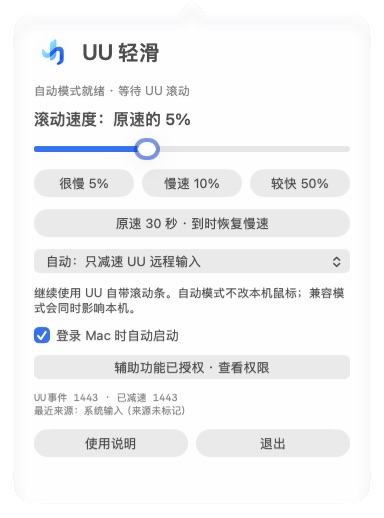
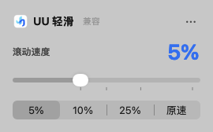

<p align="center">
  
</p>

<h1 align="center">UU 轻滑 · UU LightSlide</h1>

<p align="center"><strong>手机、iPad 远控 Mac，让页面慢下来，让操作更从容。</strong></p>

<p align="center">
  继续使用 UU 原来的滚动工具条，把速度调到适合阅读的节奏。<br>
  平时慢慢看，需要快速翻页时，一键恢复原速。
</p>

<p align="center">
  <a href="https://github.com/Dameon020/uu-lightslide/releases/download/v0.4.0/UU-LightSlide-v0.4.0-universal.dmg"><strong>下载 Mac 安装包</strong></a> ·
  <a href="#安装只需几步">安装</a> ·
  <a href="#怎么用">使用</a> ·
  <a href="#常见问题">常见问题</a> ·
  <a href="https://github.com/Dameon020/uu-lightslide/releases">全部版本</a>
</p>

> 当前开发分支已加入 **v0.5.0 滚动方向设置**：主面板分别反转上下、左右，100% 原速下也生效。公开安装包仍为 v0.4.0。

> **v0.4.0 已更新**：界面更简洁，原速可以来回切换，兼容模式不再藏起来。[查看本次更新](https://github.com/Dameon020/uu-lightslide/releases/tag/v0.4.0)

---

## 为什么做这个小工具

用手机或 iPad 通过 UU 远程操作 Mac，连接很方便，但阅读网页、文档时，总有一个让人头疼的小问题：**滚动太快了。**

按住 UU 自带的滚动工具条，稍微动一下，页面就翻过了想看的位置。想慢慢看，只好把鼠标挪到窗口边缘，去拖那条细细的滚动条。手机屏幕本来就小，这样操作很费劲。

UU 轻滑就是为了解决这件事：

- **沿用原来的操作**：还是用 UU 的滚动工具条，不用换手势，也不用找窗口边缘。
- **把移动幅度变小**：默认调到原速的 10%，还可以继续降到 5%、2%、1%。
- **快慢随时切换**：点“原速”快速翻页，再点一次回到上次慢速；也可按住 ⌥ 点菜单栏图标切换。

装在被控的 Mac 上，授权一次，让它留在菜单栏里就好。

## 看看界面

<p align="center">
  
</p>
<p align="center"><em>v0.4.0 实机截图。日常只调速度，其他设置收进右上角的「⋯」。</em></p>

## 这次更新，少一点设置

现在只记住一条：**低于 100% 就减速，选择原速就恢复。**

- **主界面做减法**：去掉常驻的事件计数、来源文字、独立开关和 30 秒倒计时，只留下速度滑块与四个常用档位。
- **快一下，再慢下来**：点「原速」恢复 UU 的正常速度，再点一次就回到上次慢速，不必重新找 5%。
- **兼容模式看得见**：开启后标题旁显示「兼容」，点一下切回自动识别。它会影响本机鼠标，选择也会记住。
- **需要操作时再提示**：未授权时引导授权；检测到 UU 连接信号且持续收到未标记滚动时，提供兼容模式入口。
- **升级不用重新设置**：保留已保存的速度（包括 50% 等自定义值）和自启动选择。已保存的兼容选择也会保留；旧版本若只在内存中启用了兼容模式，升级后需重新选择一次。

<p align="center">
  
  
</p>
<p align="center"><em>兼容与原速状态的原生界面渲染。</em></p>

## 能做什么

| 功能 | 用起来是什么样 |
| --- | --- |
| 自动处理 UU 输入 | 应用运行时，识别到 UU 发来的滚动就自动减速，每次连接不用重新开关 |
| 1%–100% 调节 | 轻轻调滑块，找到自己舒服的速度；改完自动保存 |
| 常用速度一键选 | 5%、10%、25%、原速；自定义 50% 等数值也会保留 |
| 原速来回切换 | 点原速恢复正常速度，再点一次回到上次速度；支持 ⌥ 点菜单栏图标 |
| 菜单栏常驻 | 减速就绪时显示百分比，原速时仅显示图标 |
| 登录自动启动 | Mac 登录后自动运行，也可以在更多菜单里取消 |
| 本机鼠标保持原样 | 自动模式只减速能识别为 UU 来源的输入 |
| 本地运行 | 无账号、无联网、无遥测；不读取网页或文档内容 |

## 下载

**普通用户下载 DMG 即可，不需要下载源码，也不需要安装开发工具。**

- **[下载 UU 轻滑 v0.4.0 · Mac 安装包](https://github.com/Dameon020/uu-lightslide/releases/download/v0.4.0/UU-LightSlide-v0.4.0-universal.dmg)**
- [备用：应用 ZIP](https://github.com/Dameon020/uu-lightslide/releases/download/v0.4.0/UU-LightSlide-v0.4.0-universal.app.zip)
- [查看版本说明与校验和](https://github.com/Dameon020/uu-lightslide/releases/tag/v0.4.0)

需要 **macOS 13 或更新版本**，被控 Mac 和手机／iPad 上已有能正常使用的 UU 远程。安装包同时包含 **Apple Silicon（M 系列）和 Intel** 架构。

> 本工具只装在**被远程控制的 Mac** 上；手机和 iPad 无需额外安装任何东西。
>
> 当前为**未经过 Apple 公证的社区版**。首次打开可能被 macOS 拦截，按下方步骤处理。Apple Silicon 已有实际远控使用反馈；Intel 已完成交叉编译，尚未实机验证。

## 安装只需几步

1. 下载并打开 `.dmg`，把 **UU轻滑.app** 拖入 **Applications（应用程序）**。
2. 推出安装磁盘，从“应用程序”打开 **UU轻滑**。
3. 首次启动会显示引导，在面板里选择 **授权辅助功能**。
4. 在 **系统设置 → 隐私与安全性 → 辅助功能** 中允许 **UU轻滑**。不同 macOS 版本的权限名称可能有所不同。
5. 回到应用选一个速度，再用手机或 iPad 通过 UU 连接这台 Mac，操作原来的滚动工具条。首次识别成功会显示 **已识别到 UU 滚动 ✓**。

授权后应用会自动重新建立滚动监听，无需手动重启；旧用户升级后可直接继续使用。如果需要重新走一遍引导，可从 **⋯ → 使用引导** 打开。

**首次打开被拦住时：** 先尝试打开一次，再进入 **系统设置 → 隐私与安全性**，找到该应用的提示并选择 **仍要打开**。只在确认下载来源可信后操作，具体以 [Apple 官方说明](https://support.apple.com/102445) 为准。此步骤与辅助功能授权是两件事。

## 怎么用

### 平时慢慢看

默认自动识别 UU。默认是原速的 10%；如果还觉得快，就选 5% 或继续往左调。速度会自动记住，不用每次重设。

手机上继续用 UU 自带的滚动工具条。Mac 菜单栏会显示当前比例，例如 `↕ 5%`。

### 偶尔想快速翻页

点 **原速**，再回到页面使用 UU 滚动工具条。再点一次“原速”回到上次慢速；按住 **⌥ Option** 点菜单栏图标也能来回切换。

这里恢复的是 UU 原来的速度，**不会直接跳到文档顶部或底部**。

### 想暂时停用

选择 **原速（100%）**，或者退出应用。无需额外开关。

## 常见问题

<details>
<summary><strong>装好了，为什么还是没有变慢？</strong></summary>

先完成辅助功能授权，并选择小于100%的速度。首次引导会在收到UU输入时显示“已识别到 UU 滚动 ✓”；平时的事件计数可在 **更多 → 诊断信息** 中查看。

如果 UU 计数始终为0，可能是当前 UU 版本或输入路径没有保留可识别的来源。可以在 **更多 → 高级设置** 中开启兼容模式。只有检测到UU的连接信号且连续出现未标记滚动时，主界面才会主动建议切换；提示不代表能确定那些事件来自UU。

兼容模式会同时影响本机鼠标，远程结束后应切回自动；兼容模式会保存到下次启动，标题旁始终显示“兼容”标签，点标签即可回到自动。

</details>

<details>
<summary><strong>已经连上了，为什么还显示“等待 UU 滚动”？</strong></summary>

这条提示只在首次引导的验证步骤显示；看到“已识别到 UU 滚动 ✓”后引导自动结束。日常主面板不再展示等待状态。

</details>

<details>
<summary><strong>会影响我坐在 Mac 前使用鼠标或触控板吗？</strong></summary>

自动模式下，普通本机鼠标和触控板输入原样通过。只有手动选择“兼容模式（也影响本机）”时，才会一起减速。

Ctrl、Command、Option 配合滚轮的组合动作保持原样，避免改变缩放等操作。

</details>

<details>
<summary><strong>所有软件都能像素级平滑滚动吗？</strong></summary>

应用会缩小系统滚动事件的移动量，但最终呈现还取决于目标软件。个别程序按行或按页吸附，可能仍会出现步进效果。目前没有逐一验证所有应用。

已有 macOS 27.0.1、UU 4.43.1、Apple Silicon 环境的真实手机/iPad远控反馈，确认滚动明显变慢，整体体验良好。欢迎反馈其他组合的使用情况。

</details>

<details>
<summary><strong>为什么需要辅助功能权限？会读取我的内容吗？</strong></summary>

这是 macOS 允许程序调整输入事件所需的权限。工具只订阅滚轮事件，检查其来源并缩小移动量，不监听键盘文本，不读取屏幕、网页、文档或 UU 账号，也不会上传数据。

速度和兼容模式保存在本机；事件计数只在诊断菜单中查看。为减少误导，识别提示还会读取系统电源断言中的UU连接信号，不读取UU账号或设备信息。

</details>

<details>
<summary><strong>升级后提示重新授权，或者安装包无法打开怎么办？</strong></summary>

社区版未经过 Developer ID 签名与 Apple 公证，升级后可能需要重新确认授权。如果辅助功能列表里已有旧条目，可移除后重新添加当前应用。

如果系统提示文件损坏，先核对 Release 中的 SHA256 校验和并重新下载；也可以从源码构建。不要为了运行工具关闭整个系统的安全保护。

</details>

## 卸载

1. 在 **更多** 菜单中取消 **登录 Mac 时自动启动**。
2. 点击 **退出**。
3. 将“应用程序”中的 **UU轻滑.app** 移到废纸篓。
4. 在系统辅助功能权限列表中移除 UU轻滑。

## 从源码构建

需要 macOS 与支持 macOS 13+ SDK 的 Xcode 或 Command Line Tools。使用 Swift 和系统自带的打包工具，无第三方包依赖。

```bash
git clone https://github.com/Dameon020/uu-lightslide.git
cd uu-lightslide
./build.sh
```

应用位于 `dist/UU轻滑.app`。更多命令：

```bash
./test.sh                   # 合成滚动事件与算法检查
./package.sh                # DMG、应用ZIP、源码ZIP和校验和
ARCHS=arm64 ./build.sh       # 仅构建Apple Silicon
ARCHS=x86_64 ./build.sh      # 仅构建Intel
```

技术实现、兼容边界见 [工作原理](docs/HOW_IT_WORKS.md)，正式签名与公证流程见 [发行指南](docs/RELEASING.md)。

## 反馈与开源

遇到问题或有改进想法，欢迎 [提交 Issue](https://github.com/Dameon020/uu-lightslide/issues)。请注明 macOS、芯片、UU版本、目标软件及使用模式；不要上传账号、设备验证码或完整个人日志。

感谢 [Better Remote](https://github.com/pincc-debug/better-remote) 的远控连接识别思路；相关 MIT 归属说明见 [NOTICE](NOTICE.md)。

感谢 [UUyc-companion](https://github.com/aoyamashou/UUyc-companion) 对 Mac 远控体验的探索，本项目介绍页的组织方式也参考了它的清晰表达。

**UU 轻滑是独立项目，与网易或 UU 远程无隶属关系。** 产品名称与第三方商标属于各自权利人，详见 [第三方说明](NOTICE.md)。

[MIT License](LICENSE) © 2026 Rixin Zhao and contributors
